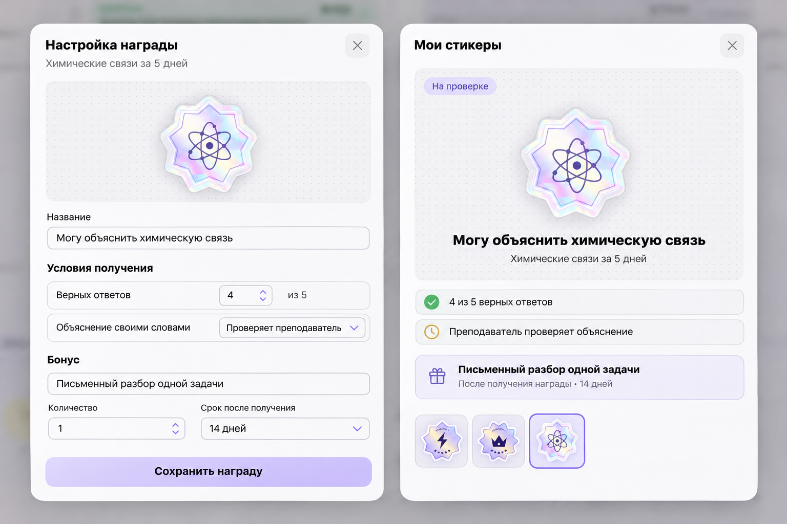

# «Мои стикеры» — награды за интенсив

[Открыть в Figma](https://www.figma.com/design/y8qQ23hqFJtufp7gGdZTse/?node-id=253-82)

3 ноября 2026. По решению пользователя работу над концептом поставили на паузу. Общее направление нравится. Когда вернёмся, нужно немного доработать дизайн и логику. Конкретные правки обсудим отдельно.

В последнем макете два экрана. Преподаватель задаёт условия достижения и бонус. Ученик в «Моих стикерах» видит, за что получит награду, какие условия уже выполнил и когда сможет воспользоваться бонусом.

Пример для обсуждения — интенсив «Химические связи за 5 дней». Условия в макете — минимум 4 верных ответа из 5 и объяснение своими словами, которое принимает преподаватель. Бонус в примере — письменный разбор одной задачи в течение 14 дней после получения награды. Внутренняя валюта остаётся отдельной идеей.
