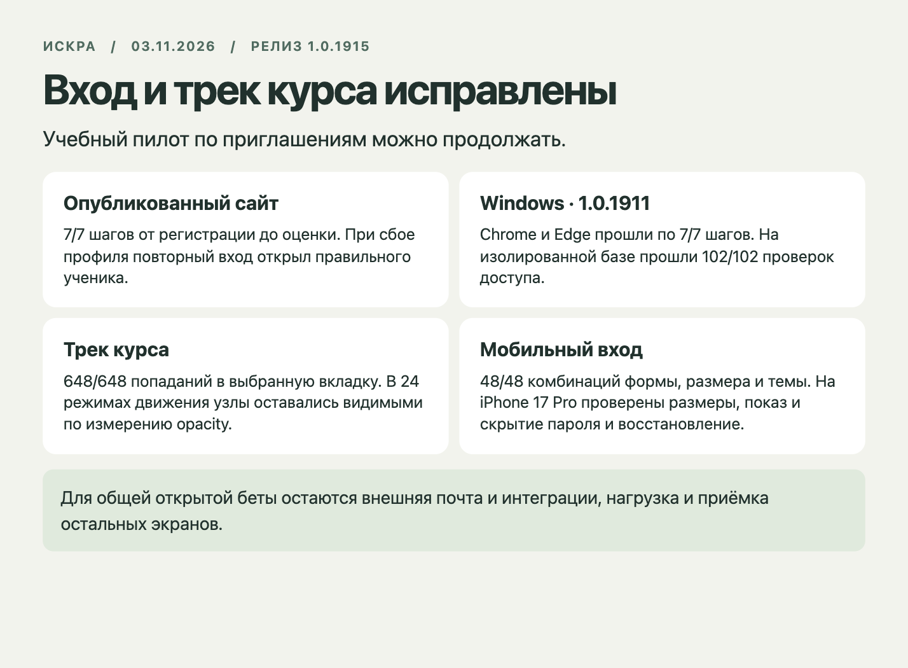

# Искра · исправления входа и трека курса · 3 ноября 2026
 
**Последняя проверенная публичная версия — 1.0.1915**, SHA aaedce19c84547aae54849f16b917a3cbefe5094. На ней повторены [все 7 шагов учебного цикла](latest/prod-ui.json) и [отказ профиля с успешным повтором](latest/prod-entry-fault.json). Семь файлов продукта, относящихся к исправлениям, совпадают с проверенным на Windows коммитом b35fae6b. [Манифест релиза](latest/release.json) и [манифест версии](latest/version.json).

Первый проверенный публичный выпуск с исправлениями — **1.0.1911**, коммит **b35fae6b78145ad821ae77bce1446fd0675a65e5**. Выпуск прошёл из main через Git-интеграцию. Проверка кандидата первоначально выполнялась на 434e6a26. Пока шёл CI, в main вышла 1.0.1910. Повтор на собранном из 1872d5c3 клиенте находится в final/. Вышедший параллельно b35fae6b уже включает все семь исправленных файлов продукта байт в байт. Оба коммита имеют номер 1.0.1911. Для опубликованного SHA дополнительно повторены [4/4 проверки входа](published/login/student-browser.json), [запоздавший ответ](published/race/ownership-race.json) и покадровая проверка трека. Публичные прогоны ниже выполнены на b35fae6b, Windows запущен с явным checkout этого же SHA и проверкой git rev-parse. [Опубликованные манифесты](production-manifests.json) · [CI кандидата 1872d5c3](https://github.com/Dany-tut/Edu-study/actions/runs/41581778754) · [Календарь](https://github.com/Dany-tut/Edu-study/actions/runs/41581778494).

| Где | Что проверено |
|---|---|
| Публичный сайт, Chrome/macOS | [7/7 шагов](production.json) от приглашения до опубликованной оценки. Подготовка задания через API. В браузере [отказ профиля, сохранение ввода и успешный повтор](production-fault.json). Работал настоящий Auth с вымышленным учеником, 503 подставляли только в один браузер. Оба набора тестовых данных удалены. |
| Изолированный Supabase на Windows | 102/102 проверок ограничения доступа. Нативные Chrome и Edge прошли по 7/7 шагов. [Артефакты](published/windows/) · [GitHub Actions](https://github.com/Dany-tut/Edu-study/actions/runs/41582394837). |
| Локальная сборка 1872d5c3, настоящие Auth и БД | [Вход, отказ, повтор и отмена](final/login/student-browser.json), [запоздалый ответ другого ученика](final/race/ownership-race.json), [10/10 возврат, две попытки и оценка](final/return.json). Первоначальный тест входа попал в смену документа при reload. Повтор ждёт загрузки нового документа и проверяет ID. |
| Учебный трек, отдельный стенд с компонентами опубликованного b35fae6b, Chrome/macOS | [648/648 кликов](published/pointer.json) попали в центр нужной видимой вкладки и выбрали её. На телефоне выполнялась предварительная прокрутка к цели. [672/672 проверки состояния](published/motion/motion-actions.json). В [24 комбинациях](published/motion/motion-frames.json) соседние вкладки не накладывались, opacity узлов оставалась выше нуля. Оба направления, быстрые повторы, Enter, шесть размеров, две темы и reduced motion. |
| Четыре формы авторизации | [48/48](final/auth-visual/results.json) комбинаций в Chrome. [32/32](final/forms/results.json) проверок размеров и верхнего/нижнего края прокрутки. В тестах форм приглашения использовались подставные RPC-ответы. Первоначальный общий прогон дал два тайм-аута по 2,5 секунды и одно дробное измерение 43,99997 px. Приведён повтор с допуском 0,0001 CSS px и тайм-аутом 8 секунд. |

Исправлен порядок входа. Профиль читается до записи общей сессии. Сбой чтения оставляет пользователя в форме с возможностью повторить вход. Поздний ответ прошлого пользователя отбрасывается. На формах расширена область переключателя пароля и восстановлена клавиатурная навигация. В треке выбор сразу устанавливает геометрию вкладок, а плавное появление подписи сохраняется.

На физическом iPhone 17 Pro пройдены измерение зоны, показ и скрытие пароля и переход к восстановлению с возвратом. [Результат устройства](iphone-pass.txt).

На физическом iPad Xcode сообщил, что устройство не включено в профиль подписи тестового runner. Safari WebDriver также не создал сессию. Покрытие iPad ограничено эмуляцией размера.

**Решение.** Выпуск закрывает три дефекта предыдущей приёмки. Пилот по приглашениям можно продолжать. Перед открытием всей платформы остаются внешняя доставка почты и включённые интеграции, проверка ожидаемой нагрузки и незакрытые экраны общей матрицы. [Подробности общей приёмки](../consolidated-2026-11-03/README.md).
