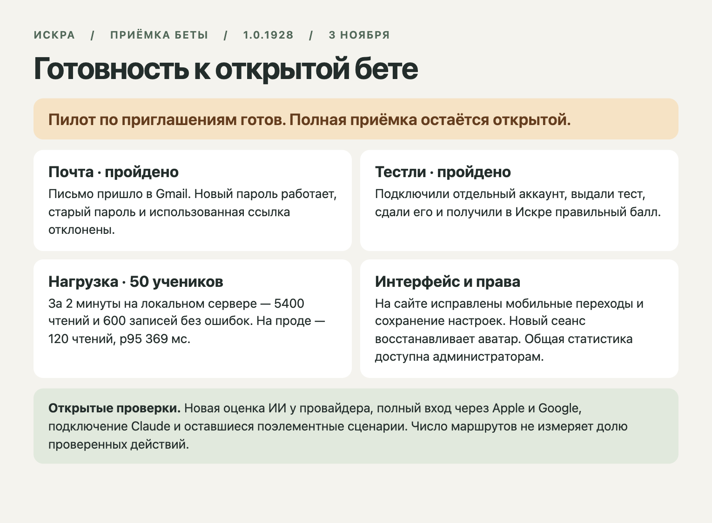

# Искра — почта, интеграции, нагрузка и экраны

**Пилот по приглашениям можно продолжать. Полная открытая бета остаётся без допуска.** Карточка охватывает реальные внешние сервисы, изолированную базу, сквозные браузерные проверки и ограниченный трафик рабочего сайта. Начальный прогон backend и почты прошёл при публичной оболочке 1.0.1918, d23624467b716020ae41aca50e1cb663bf0adae1. Обзор интерфейса повторён при 1.0.1922, 3601666e22f1529dad1811ba48b1940adb2d8417. Для исправлений собрана отдельная ветка от main. [Карточка приёмки](scenario.md).

**Выпуск 1.0.1928 на рабочем сайте подтверждён**. Обе версии манифеста содержат b2ad04ad6935f3b061b08d65d8157ac3d869b1ef. После выпуска повторены сброс через Gmail с видимым подтверждением и чтение выбранного аватара в новой браузерной сессии. [Манифесты](production-manifests.json) · [Почта после выпуска](mail-ui-shipped.json) · [Настройки на сайте](prod-prefs-ui.json) · [Обязательный CI](https://github.com/Dany-tut/Edu-study/actions/runs/41586663065).

| Область | Что произошло в проверке |
|---|---|
| Внешняя почта | Письмо от Искры пришло во входящие Gmail. В Chrome пользователь запросил сброс на сайте, открыл ссылку из письма и сохранил новый пароль. После этого вход со старым паролем и повторное использование ссылки были отклонены. Обнаружено исчезновение подтверждения после перехода на экран входа. В исправленном клиенте проверены показ сообщения, его исчезновение после F5 и новый вход. [Почта](mail.json) · [Браузер и Gmail](mail-ui-retry.json) · [Повтор на кандидате](recovery-candidate.json). |
| Тестли | В двух настоящих проектах созданы временные учитель и ученик. Одноразовый код связал аккаунты. Тест появился в списке, ученик получил персональное приглашение и сдал работу. В Искре получены полный балл и тот же результат при повторном чтении. Шесть шагов через API, очистка прошла. [Результат](testly-live.json). |
| ИИ | Опубликованная функция с настоящими серверными учётными данными получила каталог из 65 моделей. За семь дней в БД три оценки в состоянии graded, девять skipped и одна ошибка balance. Стоимость генерации не проверяли новым платным запросом при бюджете $0. [Каталог](ai-models.json) · [Агрегаты](ai-status.json). |
| Другие интеграции | Apple и Google вернули 302 на свои настоящие страницы входа. Согласие у провайдера и возврат реальной личной учётной записи не пройдены. Для Claude рабочий endpoint MCP и проверенный endpoint OAuth вернули 404. В кандидате форма показывает недоступность и убирает инструкцию подключения при ошибке загрузки. [Ответы провайдеров](social-start.json) · [Незакрытые проверки](ai-blockers.json). |
| Нагрузка | Первый локальный прогон дал 3 000 чтений без ошибок и нарушения изоляции при параллелизме до 50. Отдельный прогон с 50 настоящими тестовыми сессиями обнаружил запрет записи настроек у всех 50. После исправления за 120 секунд прошло 5 400 чтений (p95 92 мс) и 600 записей (p95 469 мс). Каждое чтение проверяло собственный результат и отсутствие чужой строки. На рабочем сервере проверены 120 чтений при ограничении 4 запроса/с, p95 369 мс. Это не оценка предельной ёмкости или часового пика в проде. [Локальные чтения](load.json) · [До исправления](soak-before.json) · [После](soak.json) · [Рабочий сервер](production-reads.json). |
| Приватность | Преподаватель по прямому адресу получал статистику всей БД. Теперь база допускает администратора и служебный ключ. Проверены запрет для анонимного клиента и ложной роли в user_metadata, допуск доверенной роли и отказ реальному обычному аккаунту. Отдельная функция записи настроек меняет только собственную запись ученика и только разрешённые поля. Проверены сохранение настроек, отказ на чужой ID и запрещённое поле. [Проверка БД](storage-live-roles.json) · [Настройки на проде](prod-preferences.json) · [Восстановление аватара в новом браузере](prefs-ui.json). |
| Интерфейс | Обзор 18 маршрутов × 2 ширины × 2 темы в опубликованном клиенте, 72 записи. Это инвентарь, проверка загрузки и поиск проблем. Совпадение текста в меню или загрузка оболочки не доказывает работу конкретного раздела. Отдельно проверены 20 сочетаний исправленных страниц, открытие/закрытие платежа, запрет статистики и прокрутка профиля. На телефоне прямой URL раньше открывал «Мой день» вместо нужного инструмента. В кандидате профиль ведёт в финансы и конструктор. [Инвентарь](public-screens.json) · [Целевые проверки](exact/public-screens.json) · [Начало, середина и конец прокрутки](exact/edges-overview.jpg) · [Действия и переходы](interactions/actions.json). |
| Учебный цикл | На локальной сборке с настоящей БД прошли регистрация, сдача, возврат, повторная сдача, оценка, свежий вход и просмотр обеих попыток. [10 шагов](return.json). |

**Повтор после публикации.** На 1.0.1928 завершены [20 целевых проверок страниц](production-ui/public-screens.json) и [18 сценариев взаимодействия](production-actions/actions.json) на десктопе и телефоне, в двух темах. Для вкладок исправлена первоначальная проверка длины текста, которая ошибочно считала короткий экран дефектом. В итоговом драйвере проверяется выбор нужной вкладки, а для тестов также появление сетки тестов. Для созданных аккаунтов и записей подтверждена очистка.

**Что ещё открыто.** Полный внешний цикл Apple/Google и Claude, новая оценка ИИ на действующем балансе, сквозная проба всех типов заданий и редактирования, keyboard/screen reader, zoom и контраст на всех экранах. В этой партии не проверялось каждое физическое устройство и не моделировался длительный пик на рабочей инфраструктуре. Финансовая форма проверена на открытие и отмену, реальная покупка подписки не совершалась. Эти клетки не включены в зелёный результат. [Общая поэлементная матрица](../element-action-matrix.md).
