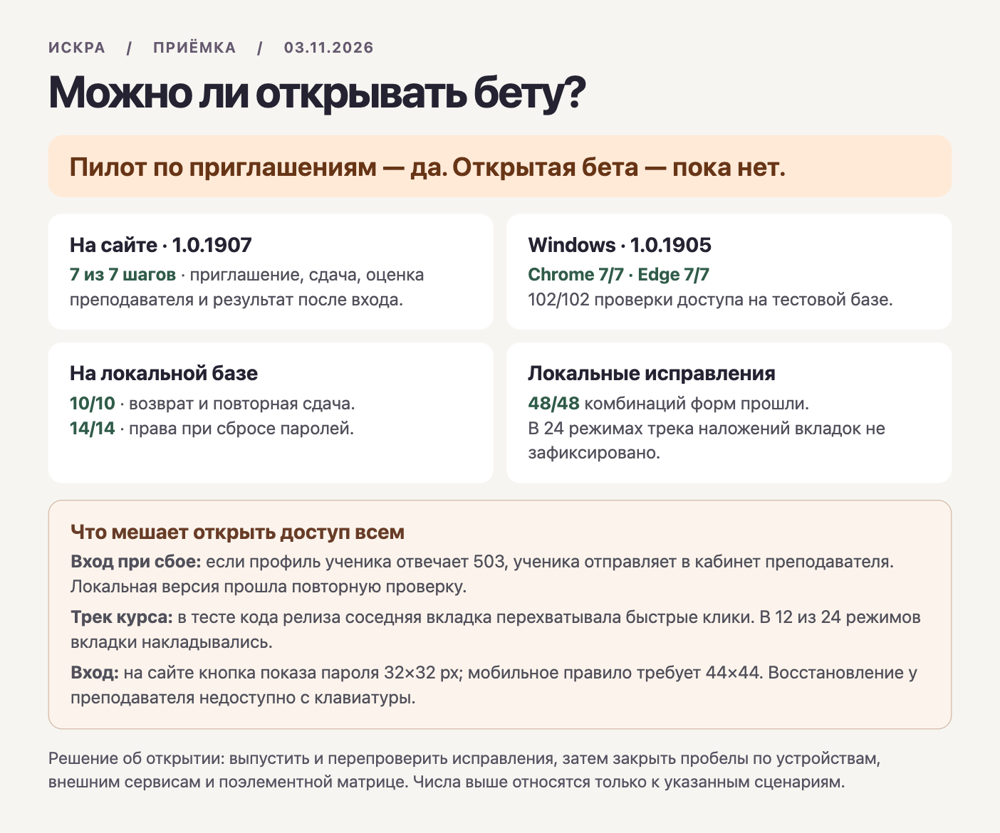

# Искра · повторная приёмка 3 ноября 2026

**Закрытый учебный пилот по приглашениям — да. Открытая бета — пока нет.** Основной сценарий выдержал повтор на публичном домене и в двух браузерах Windows. Есть воспроизводимые расхождения с правилами приёмки входа и переключения модулей. Этот прогон ничего не публиковал в production.

| Среда | Проверенный код | Что реально повторили |
|---|---|---|
| Публичный сайт, Chrome на macOS | сначала **1.0.1905**, fef1fb786528da81f77f601750d6534b229f4f6c; затем **1.0.1907**, a8bc30777e221f68afef223e2e7c3651d3dfe5dc | [7/7 на 1905](production.json), [7/7 на 1907](production-1907.json). Приглашение и регистрация ученика, черновик и reload, сдача с обрывом ответа, одна попытка в БД, просмотр и ручная оценка преподавателем, свежий вход ученика. Подготовка задания через API, остальное через UI; синтетическая группа удалена после каждого прогона. [release.json](production-manifest.json) и [version.json](production-version.json) совпали на 1907. |
| Windows GitHub Actions, изолированный Supabase | точный SHA **1905** | [Зелёный прогон](https://github.com/Dany-tut/Edu-study/actions/runs/41579784009): [102/102 API и изоляция](windows/api-matrix.json), [первый браузер](windows/browser-replay-1793681361115/result.json) и [второй браузер](windows/browser-replay-1793681389348/result.json) — Chrome и Edge по 7/7. [Обязательный CI того же коммита](https://github.com/Dany-tut/Edu-study/actions/runs/41579784050). Windows для **1907** в эту цифру не входит. |
| macOS, локальная БД и браузер, синтетические роли | клиент/драйверы релиза **1905**; уже запущенный локальный backend | [102/102 матрица доступа](local-db/api-matrix.json), [14/14 сброс паролей и авторизация](local-db/edge-auth.json), [10/10 возврат и повторная сдача с двумя попытками](local-db/return.json). [Три SQL-сценария оплаты](local-db/payments-regression-latest.json) с откатом, [восстановление через локальный почтовый ящик](local-db/recovery-mail.log), [340 параллельных/последовательных чтений](local-db/concurrent.log). Результат чтений не оценивает ёмкость прода. |
| Рабочая копия, включая неопубликованные изменения | база 2dfc71679cb16dc72078a80b713f13a84bc98023 + [исходный хеш diff](local-diff-hash.txt); для сравнения UI заморожена отдельная копия [с хешем исходников и fixture](candidate-hash.txt) | Выполнены все 39 команд check:* из package.json. [Исходные коды выхода](checks.tsv): 37 сразу успешны; два повтора прошли: [участие в уроке](participation-retry.log), [календарь на свободном порту](calendar-retry.log). Отдельно [7 security-скриптов](security-checks.txt), 12 [сценариев прерывания форм](forms/results.json), 5 [сценариев social login](social/results.json) с имитацией сети/провайдера. Общая копия изменялась, поэтому это не аттестация единого чистого релиза. |

## Что нашла новая проверка

1. **Сбой профиля при входе.** На сборке 1905 с настоящим локальным Auth и ответом 503 вместо профиля ученика тест не дождался сообщения об ошибке; [отдельная запись состояния](login-faults/observed.json) через 18 секунд показывает восемь запросов профиля, переход ученика на #/teacher, сохранённую Auth-сессию и отсутствие alert. Тайм-аут исходного теста подтверждён отдельным наблюдением как дефект продукта. Это сбой клиентской обработки; выдача серверных прав преподавателя не доказана. На локальном кандидате [4/4](login-faults-candidate/student-browser.json): ошибка и введённые данные, успешный повтор, отмена с поздним ответом и F5, а также обычный вход преподавателя.
2. **Мобильный вход и клавиатура.** На [живой 1907](live-auth-1907.json), в обеих темах, ширины 320/390/1440: зона показа пароля 32×32. На телефоне требуется минимум 44×44. В релизе восстановление у преподавателя сделано кликабельным span без клавиатурного фокуса. На стенде четыре формы × шесть размеров × две темы не прошли проверку 44 px; на десктопе это порог данного теста, не мобильное требование. Ещё два отказа — переход к восстановлению преподавателя с клавиатуры. [Релиз](auth-visual/results.json) / [локальные исправления: 48/48 комбинаций](auth-local/results.json). Проверка прерывается на первой ошибке каждой комбинации; последующие действия такой строки не считаются пройденными.
3. **Смена модулей.** Компоненты релиза на локальном стенде: 6 размеров × 2 темы × 2 режима анимации. Все 672 проверки выбранного/закрытого состояния отработали, но [покадровая геометрия](motion-prod/motion-frames.json) обнаружила наложение соседних вкладок в 12/24 режимах, нулевую непрозрачность узла хотя бы на одном кадре — в 24/24. Из [648 быстрых координатных кликов](pointer-prod.json) **97** попали в другую вкладку внутри окна и не выбрали ожидаемый модуль. Центры вне экрана или вне видимой кнопки отдельно помечены в [матрице](matrix.tsv). Сырой итог по несовпадению выбора — 184 у релиза и 74 у кандидата. Из них соответственно 87 и 73 не подтверждают попадание курсора на какую-либо вкладку: это ограничение координатного драйвера, не доказанный дефект продукта. В матрице все события без цели, включая совпадение предыдущего выбора, помечены NOT TESTED. Строки FAIL — наблюдения, а не число уникальных дефектов.
4. **Сравнение локальных исправлений.** В том же сценарии кандидата [0/24 наложений и 0/24 кадровых серий с нулевой непрозрачностью](motion-candidate/motion-frames.json), 672/672 проверок состояния. При быстрых кликах [574 успешных попадания из 575, для которых курсор указывал на вкладку](pointer-candidate.json); один выбор не подтвердился, остальные 73 центра не указывали на кнопку. Мобильную прокрутку к цели и этот одиночный результат надо закрыть до выпуска. Геометрия и opacity не доказывают визуальную доступность всех пикселей.
5. **Принадлежность данных:** [записи кадров](identities.json) при смене модуля проверяют идентификаторы всех шести уроков и соответствие счётчиков 7/12/100; у модулей одинаковое количество уроков. Две ширины, Chrome, отдельный компонентный сценарий. Введённая в тестовые данные ошибка «всегда показывать уроки первого модуля» была обнаружена во всех четырёх контрольных прогонах. Эти данные статичны: поздний сетевой ответ одного модуля после выбора другого здесь не проверен.

## Остальные границы

[Календарь: 150 сценариев](calendar/results.json) проверяет принадлежность карточек дате после ожидания правильного результата. Он не исключает показ чужой даты на промежуточном кадре. Проверка наличия CSS-маски не доказывает правильность обоих краёв. [Окно платежа: 47 состояний](teacher-geometry/results.json) — открытие, resize, закрытие и смена экранов; на узком экране изменялся размер уже открытой формы. Это не проверка мобильного входа в финансы и не операция с деньгами.

[Матрица фактических действий](matrix.tsv) и [общий инвентарь непокрытых клеток](../element-action-matrix.md). Отдельно остаются: все комбинации экранов и состояний, контраст с прозрачностью и увеличение текста, screen reader, физические телефон и планшет на текущей версии, доставка письма внешнему адресату, реальные ИИ и Тестли, финансовый цикл в целевом окружении, восстановление БД из копии, нагрузка предполагаемой беты и проверка исторических назначений ролей. Не переносить сюда результаты предыдущих дат или симулятора без повторной проверки.

**Порядок до открытия:** включить исправления входа и трека в чистого кандидата, закрыть последний промах при быстрых кликах и клавиатуру, прогнать отказ/повтор и полный Windows-цикл для его точного SHA; затем реальные устройства и внешние интеграции, которые войдут в бету. Между 1905 и 1907 изменился отступ ручки ресайза виджетов и номер версии. Поэлементную геометрию этой ручки на 1907 данный прогон не подтверждает.
